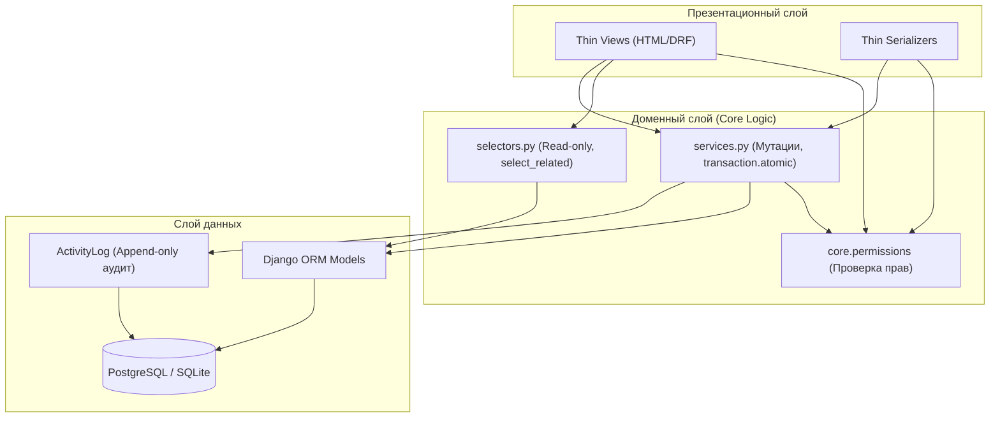
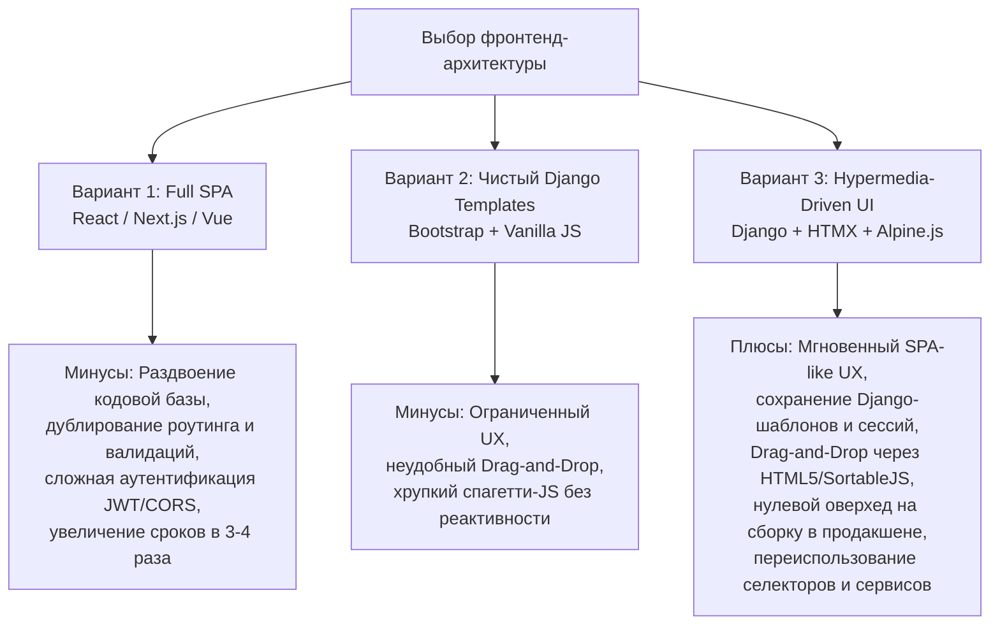
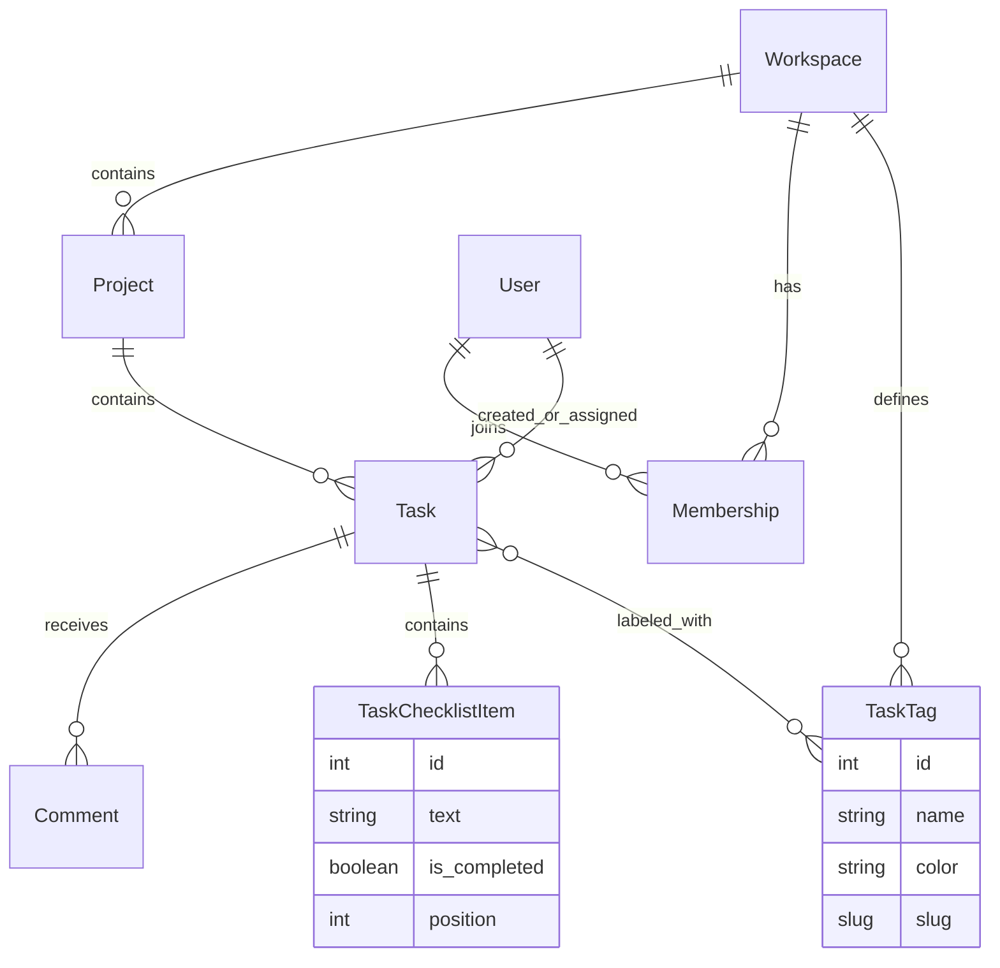
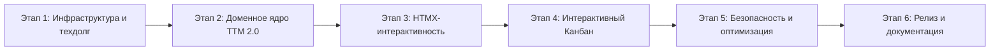

# TTM 2.0 — Инженерный отчет: Анализ и архитектурное проектирование модернизации

---

## 1. Введение и цели модернизации

Проект **Team Task Manager (TTM)** представляет собой надежную, продуманную сервис-ориентированную SaaS-систему на базе **Django 5.1**, **PostgreSQL** и **Django REST Framework**.

Цель инициативы **TTM 2.0** — эволюционное развитие продукта из демонстрационного CRUD-приложения в полноценный, высокопродуктивный инструмент командной работы современного уровня без переписывания с нуля и без разрушения сильного архитектурного фундамента.

> **Ключевой принцип модернизации:**
> Сохранение строгой изоляции слоев (`services` для мутаций, `selectors` для выборки, `core.permissions` для авторизации), стабильности REST API контрактов, транзакционной целостности и мульти-тенантной модели доступа `User → Membership → Workspace → Project → Task`.

---

## 2. Глубокий аудит существующего состояния

### 2.1. Исходные метрики кодовой базы
- **Стек:** Python 3.12/3.13, Django 5.1.5, DRF 3.15.2, PostgreSQL 15 / SQLite fallback, Whitenoise, Sentry SDK, drf-spectacular.
- **Приложения (8):** `accounts`, `workspaces`, `projects`, `tasks`, `comments`, `activity`, `api`, `core`.
- **Ветка:** Разработка TTM 2.0 изолирована в новой ветке `develop/ttm-2.0` (ответвлена от стабильной `master`).
- **Текущий CI:** GitHub Actions запускает линтинг Ruff, `manage.py check`, проверку дрифта миграций, целостность домена (`check_domain_integrity`), тесты с базой PostgreSQL и контроль покрытия (порог **85%**).

---

### 2.2. Анализ с позиции Software Engineer (Архитектура, техдолг, безопасность)



#### Сильные стороны текущей архитектуры:
1. **Чистое разделение ответственности:** Бизнес-правила не размазаны по контроллерам или сериализаторам, а изолированы в `services.py`.
2. **Оптимизация чтения:** Селекторы централизованно подгружают внешние ключи через `select_related("project", "created_by", "assignee")`, минимизируя проблему N+1 запросов.
3. **Неизменяемые уникальные slug:** Модуль `core.slugs` детерминированно формирует читаемые идентификаторы с ограничением скоупа (внутри воркспейса или проекта).
4. **Аудит изменений:** `ActivityLog` ведет append-only историю ключевых действий по воркспейсам.
5. **Валидация доменных инвариантов:** Утилита `core/integrity.py` на уровне тестов и CI проверяет 7 критических инвариантов (единственность владельца, корректность инвайтов, привязку исполнителей к воркспейсу).

#### Выявленные дефекты и технический долг:
1. **Портативность локальных скриптов (Critical DX bug):**
   В файле `bootstrap_ttm_local.cmd` захардкожен абсолютный путь конкретной машины:
   ```cmd
   set "BUNDLED_PYTHON=C:\Users\nande\.cache\codex-runtimes\codex-primary-runtime\dependencies\python\python.exe"
   ```
   На машинах других инженеров (например, пользователя `kiril`) скрипт не находит исполняемый файл и завершается с ошибкой. Необходимо заменить на `%USERPROFILE%` с динамическим fallback на системный `python`/`py`.
2. **Пустые файлы тестов:**
   Файлы `accounts/tests.py` и `activity/tests.py` имеют размер **0 байт**. Профиль пользователя, регистрация и селекторы активности тестируются лишь косвенно через API, что снижает изоляцию unit-тестирования.
3. **Отсутствие пагинации в серверных шаблонах:**
   В HTML-представлениях (`ProjectTaskListView`, `WorkspaceListView`, `WorkspaceActivityView`) списки задач, проектов и логов выводятся единым запросом без разбиения на страницы. При росте числа задач (100+ в проекте) страницы будут деградировать по памяти и времени ответа (TTFB).
4. **Утечка глобальных метаданных в `EcosystemSummaryView` (Security):**
   Эндпоинт `/ecosystem/summary/` не защищен авторизацией (`LoginRequiredMixin` отсутствует) и выполняет глобальные агрегации:
   `Workspace.objects.count()`, `open_tasks.count()`, `latest_tasks`.
   В multi-tenant архитектуре это открывает доступ к объему данных чужих клиентов любому анонимному посетителю.
5. **Неполный жизненный цикл CRUD:**
   - **Задачи (Task):** Полностью отсутствует удаление или архивация задач. Ошибочно созданную задачу невозможно убрать.
   - **Проекты (Project):** Есть архивация, но нет редактирования названия и описания.
   - **Воркспейсы (Workspace):** Нет интерфейса редактирования названия и настроек.
6. **Отсутствие асинхронного исполнителя (Background Workers):**
   Система синхронна. При добавлении почтовых уведомлений, генерации отчетов или интеграций с вебхуками синхронные запросы будут блокировать HTTP-воркеры.

---

### 2.3. Анализ с позиции Product Developer (UX/UI, пользовательские пути, ценность)

| Пользовательский сценарий | Текущая реализация (TTM 1.0) | Проблема / Ограничение | Целевое состояние (TTM 2.0) |
| :--- | :--- | :--- | :--- |
| **Смена статуса задачи** | Открыть карточку → нажать Edit → загрузить форму → изменить select → нажать Save → редирект (7 действий, 2 полных перезагрузки) | Высокое трение, демотивация обновлять прогресс | **1 клик** в выпадающем меню или **Drag-and-Drop** на Канбан-доске без перезагрузки |
| **Обзор проекта** | Только статический список карточек в 2 колонки | Нет визуализации этапов потока задач (To Do / In Progress / Done) | **Интерактивная Канбан-доска** + переключение в компактный табличный список |
| **Поиск и фильтрация задач** | В UI отсутствуют фильтры (хотя бэкенд API их поддерживает!) | Невозможно быстро найти задачи определенного исполнителя или просроченные | **Живой фильтр-бар** (статус, исполнитель, приоритет, дедлайн, поиск) с мгновенной фильтрацией без перезагрузки |
| **Декомпозиция задач** | Только заголовок и сплошной текст описания | Крупные задачи невозможно разбить на этапы без создания отдельных задач | Встроенные **чек-листы (Subtasks/Checklists)** с отметкой выполнения прямо в задаче |
| **Категоризация** | Только 3 фиксированных приоритета (Low/Medium/High) | Нельзя пометить задачу типом (Bug, Feature, Docs, Infra) | Гибкая система **меток (Tags/Labels)** с цветами в рамках воркспейса |
| **Обсуждение в задаче** | Форма комментариев перезагружает всю страницу; только plain text | Разрыв контекста, медленное общение | Мгновенная отправка комментария без скролла и перезагрузки, поддержка **Markdown** |
| **Личный фокус (Dashboard)** | Общая статистика системы и список воркспейсов | Пользователь не видит с утра, что горит именно у него | Виджет **«Мой день»**: назначенные мне задачи, просроченные дедлайны, свежие упоминания |

---

## 3. Архитектурная концепция TTM 2.0

### 3.1. Стратегия модернизации фронтенда: обоснование выбора стека

Были детально сопоставлены три альтернативы модернизации:



> **Архитектурное решение (Согласовано):** Для TTM 2.0 утверждается подход **Hypermedia-Driven Web Application (Django 5 + HTMX + CSP-совместимый @alpinejs/csp + SortableJS + Modern CSS/Bootstrap 5)**.
> 
> **Почему это оптимально:**
> 1. **Скорость и надежность доставки:** Бэкенд остается единым источником правды. Не требуется писать дублирующие DTO, сторы состояний Redux/Pinia и настраивать синхронизацию сессий.
> 2. **Бесшовная реактивность:** HTMX позволяет обновлять конкретные фрагменты DOM (колонку канбана, счетчик задач, список комментариев) в ответ на стандартные HTML/partial ответы Django.
> 3. **Минимальный бандл и безопасность:** Библиотеки загружаются легковесно (HTMX ~14KB, @alpinejs/csp ~15KB, SortableJS ~10KB). Использование `@alpinejs/csp` устраняет потребность в `unsafe-eval` и гарантирует совместимость со строгой политикой Content-Security-Policy.
> 4. **Сохранение существующего API:** Мобильные клиенты, агентские инструменты (MCP) и внешние интеграции продолжают использовать полноценный DRF REST API без изменений.

---

### 3.2. Доменные расширения TTM 2.0 (Согласованная модель)

Без нарушения существующих инвариантов доменная модель расширяется следующими сущностями (с одноуровневыми чек-листами):



1. **`TaskTag` (Метки задач):**
   - Привязка к `Workspace` (уникальность имени в рамках воркспейса).
   - Атрибуты: `name`, `color` (HEX-код), `slug`.
   - Связь `ManyToManyField` с `Task`.
2. **`TaskChecklistItem` (Пункты чек-листа задачи):**
   - Привязка к `Task` с каскадным удалением.
   - Атрибуты: `text`, `is_completed`, `position`, `created_at`.
   - Сервисы: `add_checklist_item`, `toggle_checklist_item`, `remove_checklist_item`.
3. **Расширение жизненного цикла `Task`:**
   - Поле `is_archived` для мягкого архивирования выполненных задач.
   - Сервис `delete_task` с жестким контролем прав (только автор или админ/владелец воркспейса).
4. **Безопасность метаданных:**
   - Рефакторинг `EcosystemSummaryView` с ограничением скоупа только до данных текущего авторизованного пользователя и его доступных воркспейсов.

---

## 4. Поэтапный план реализации (Roadmap)

Разработка разбита на 6 последовательных этапов с атомарными Pull Request. Каждый PR изолирован, покрыт тестами и проходит проверку CodeRabbit.



---

### Этап 1: Инфраструктурная стабилизация и ликвидация техдолга
* **Цель:** Обеспечить 100% повторяемость локального окружения, закрыть слепые зоны тестирования и исправить бреши безопасности метаданных.
* **Технические изменения:**
  - Исправление `bootstrap_ttm_local.cmd`: использование переменной `%USERPROFILE%` с автоопределением Python (3.11/3.12/3.13) и проверкой наличия `venv`.
  - Написание полноценных unit-тестов в `accounts/tests.py` (тестирование создания профиля, сигналов, формы логина/регистрации) и `activity/tests.py` (тестирование селекторов, неизменяемости логов).
  - Закрытие неавторизованного доступа к `/ecosystem/summary/` (добавление `LoginRequiredMixin`, агрегация метрик строго в разрезе воркспейсов пользователя).
  - Добавление пагинации (стандартный Django `Paginator`) в HTML-селекторы и вьюсеты списков задач и активности.
* **Зависимости:** Нет.
* **Риски:** Минимальные.
* **Критерии приемки:**
  - `bootstrap_ttm_local.cmd` успешно отрабатывает на машине с учетной записью `kiril`.
  - Все тесты `manage.py test` проходят (0 пустых файлов тестов).
  - Неавторизованный запрос к `/ecosystem/summary/` возвращает `401/403` или редирект на логин.
  - Покрытие кода по `coverage` превышает **88%**.

---

### Этап 2: Расширение доменной модели (Чек-листы, метки, удаление задач)
* **Цель:** Предоставить бэкенд-возможности для декомпозиции и категоризации задач с сохранением архитектурного паттерна `services/selectors/permissions`.
* **Технические изменения:**
  - Создание модели `TaskTag` в приложении `tasks` (или отдельном `tags`) с валидацией уникальности slug внутри воркспейса.
  - Создание модели `TaskChecklistItem` с упорядочиванием по `position`.
  - Добавление сервисов `create_task_tag`, `assign_tag_to_task`, `add_checklist_item`, `toggle_checklist_item`, `delete_task`.
  - Обновление `core/permissions.py`: права на удаление задач, управление тегами и чек-листами.
  - Расширение DRF сериализаторов (`TaskSerializer`, `TaskDetailSerializer`) с обратной совместимостью (новые поля `tags` и `checklist_items` в режиме `read_only` или опциональных входных данных).
  - Миграции БД с проверкой обратной совместимости.
* **Зависимости:** Этап 1.
* **Риски:** Нарушение целостности связей при удалении задачи (решается каскадным удалением чек-листов и очисткой связей Many-to-Many).
* **Критерии приемки:**
  - `check_domain_integrity` расширен новыми проверками и успешен.
  - Покрытие тестами новых сервисов и селекторов — 100%.
  - Существующие API-тесты проходят без изменений входных параметров.

---

### Этап 3: Внедрение Hypermedia-слоя (HTMX + быстрые действия)
* **Цель:** Устранить высокое трение в ключевых пользовательских сценариях (смена статуса задачи, добавление комментариев, живой поиск).
* **Технические изменения:**
  - Подключение `htmx.org` (локальный вендоринг в `static/vendor/htmx.min.js` для независимости от CDN).
  - Настройка глобального CSRF-токена в заголовках HTMX (`hx-headers='{"X-CSRFToken": "..."}'`).
  - Создание partial-шаблонов (`templates/tasks/partials/task_status_dropdown.html`, `templates/comments/partials/comment_item.html`, `templates/tasks/partials/task_table_rows.html`).
  - Реализация inline-переключения статуса задачи в 1 клик через `hx-post` с возвратом обновленного фрагмента карточки.
  - Добавление живого поиска и фильтрации задач в шапке списка проектов через `hx-get` с задержкой ввода (`hx-trigger="keyup changed delay:300ms"`).
  - Отправка комментариев без перезагрузки страницы (`hx-post` с добавлением элемента в конец списка через `hx-swap="beforeend"`).
* **Зависимости:** Этап 1, 2.
* **Риски:** Некорректная обработка CSRF при устаревании сессии (решается перехватом события `htmx:responseError` с показом всплывающего уведомления).
* **Критерии приемки:**
  - Статус задачи меняется за 1 клик без перезагрузки всей страницы.
  - Комментарий появляется в списке мгновенно после отправки.
  - Фильтр по строке поиска фильтрует задачи "на лету".

---

### Этап 4: Интерактивная Канбан-доска (Kanban Board)
* **Цель:** Предоставить командам современный визуальный инструмент управления потоком задач (вид по умолчанию для проекта).
* **Технические изменения:**
  - Реализация **Канбан-доски как вида по умолчанию** при переходе в задачи проекта (`/workspaces/<slug>/projects/<slug>/tasks/`).
  - Добавление переключателя видов в проекте: **Board View (по умолчанию)** ↔ **List View** с сохранением пользовательского выбора в LocalStorage.
  - Верстка колонок Канбана: *To Do*, *In Progress*, *Done* с бейджами количества задач и цветовой индикацией приоритетов/меток.
  - Подключение `SortableJS` через CSP-совместимую директиву Alpine.js: перетаскивание карточки задачи между колонками автоматически инициирует HTMX-запрос на смену статуса (`tasks/services.py:change_task_status`).
  - Оптимистичный UI: карточка фиксируется на новой позиции, а в случае ошибки прав доступа или валидации возвращается на место с демонстрацией тоста ошибки.
  - Быстрое создание задачи прямо в колонке (кнопка "+ Add task" раскрывает инлайн-инпут).
* **Зависимости:** Этап 3.
* **Риски:** Конфликты прав доступа при перетаскивании чужой задачи не-админом (сервис возвращает отказ в доступе, UI корректно отменяет drag).
* **Критерии приемки:**
  - Перетаскивание карточки между колонками меняет статус задачи в БД и фиксирует запись в `ActivityLog`.
  - Пользователь без прав на смену статуса получает понятное уведомление, карточка возвращается в исходную колонку.
  - Канбан корректно масштабируется на мобильных устройствах и планшетах.

---

### Этап 5: Производительность, безопасность и аудит (С учетом инженерных корректировок)
* **Цель:** Гарантировать высокую скорость отклика базы данных на основе доказательного профилирования и надежную эшелонированную защиту авторизации.
* **Технические изменения:**
  - **Доказательное профилирование индексов (вместо добавления вслепую):**
    - Развертывание синтетического тестового датасета на **10 000 задач** в реальном PostgreSQL.
    - Проведение предварительного профилирования ключевых селекторов через `EXPLAIN (ANALYZE, BUFFERS)` для выявления Sequential Scans, узких мест сортировки и селективности полей.
    - Выбор порядка полей в индексах строго исходя из селективности реальных фильтров (`project_id`, `status`, `priority`, `assignee_id`) и сортировок (`created_at`, `due_date`).
    - Сравнение метрик стоимости плана (cost) и времени выполнения до и после добавления индексов.
  - **Измерение времени и константности SQL:**
    - Изолированное измерение **чистого времени выполнения SQL-запроса** на уровне БД (отдельно от формирования HTML-шаблона и сетевой передачи).
    - Целевая метрика: время выполнения SQL-запроса выборки доски задач **p95 < 15 мс** на 10 000 задач в PostgreSQL.
    - Исключение N+1 проблемы: строгая проверка использования `select_related()` (для связей один-к-одному и многие-к-одному: `project`, `assignee`, `created_by`) и `prefetch_related()` (для связей многие-ко-многим: `tags`, `checklist_items`).
  - **Эшелонированная защита авторизации (Brute-force / DoS protection):**
    - Учет ограничений DRF Throttling (не гарантирует защиту от распределенного brute-force и DoS).
    - Внедрение специализированной защиты авторизации на уровне приложения / middleware (интеграция `django-axes` или специализированного блокирующего middleware с отслеживанием неудачных попыток входа по комбинации `IP + username` и временной блокировкой).
  - **Согласование CSP и Alpine.js:**
    - Использование CSP-совместимой сборки `@alpinejs/csp` (без генерации динамических функций через `Function / eval`).
    - Настройка заголовков `Content-Security-Policy` без директивы `unsafe-eval`.
    - Тестирование полной совместимости атрибутов HTMX и `@alpinejs/csp` в условиях строгой политики безопасности.
* **Зависимости:** Этапы 1–4.
* **Риски:** Регрессия скорости при избыточном индексировании (контролируется замерами `INSERT/UPDATE` оверхеда).
* **Критерии приемки:**
  - Отчет `EXPLAIN ANALYZE` до/после подтверждает ликвидацию Seq Scan и переход на Index Scan/Bitmap Index Scan.
  - Чистое время SQL p95 < 15 мс на тестовом датасете 10 000 задач.
  - Попытки подбора паролей блокируются после 5 неудачных попыток с фиксацией в аудит-логе.
  - Отсутствие CSP-предупреждений об `unsafe-eval` в консоли браузера.

---

### Этап 6: Комплексное тестирование, документация и релиз TTM 2.0 (С уточненными критериями)
* **Цель:** Фиксация высочайшего качества, проверка безопасности, документация и подготовка к объединению ветки `develop/ttm-2.0` с `master`.
* **Технические изменения:**
  - **Сквозное тестирование HTMX (включая негативные сценарии):**
    - Тесты генерации валидных partial HTML-фрагментов.
    - Проверка наличия и валидности CSRF-токена в `hx-headers`.
    - Тестирование разграничения прав: корректный возврат HTTP 403 Forbidden при попытке несанкционированного изменения статуса или чужой задачи.
    - Тестирование валидации ошибочных запросов (HTTP 400 Bad Request) с возвратом фрагмента ошибки.
    - Обработка истекшей пользовательской сессии (HTTP 401 с редиректом на логин).
  - **Глубокое тестирование бизнес-логики и прав:**
    - Общий порог покрытия тестами **> 90%** с обязательной акцентированной проверкой критических сценариев: изоляции данных между воркспейсами, передачи владения, прав архивных проектов и каскадных ограничений.
  - **Анализ замечаний CodeRabbit Review:**
    - Нулевой допуск (0) замечаний уровней `high` и `critical`.
    - Обязательное рассмотрение, аргументация и исправление всех замечаний уровней `medium` и `low`.
  - **Валидация схемы OpenAPI:**
    - Проверка актуальности схемы через `drf-spectacular`.
    - Гарантия 100% обратной совместимости API для внешних клиентов и агентов (отсутствие breaking changes).
  - **Документация:**
    - Обновление `README.md` и `CONTRIBUTING.md`: руководства по работе с Канбаном, чек-листами, локальными скриптами и CSP-политикой.
* **Зависимости:** Этапы 1–5.
* **Риски:** Расхождение документации с контрактами API.
* **Критерии приемки:**
  - Общий показатель покрытия тестами > **90%** (с 100% покрытием доменных прав и авторизации).
  - Полное рассмотрение всех замечаний CodeRabbit.
  - Swagger UI на `/api/docs/` валиден и не имеет дрифта схем.

---

## 5. План миграции данных и управление блокировками в PostgreSQL

При миграциях на продакшен-базах PostgreSQL добавление полей и таблиц требует аккуратного управления блокировками:

1. **Добавление полей в существующие таблицы (`Task.is_archived`):**
   - В PostgreSQL 11+ добавление столбца с константным значением `DEFAULT` (например, `default=False`) не переписывает таблицу физически, однако операция `ALTER TABLE ... ADD COLUMN` требует кратковременной эксклюзивной блокировки `ACCESS EXCLUSIVE`.
   - Для предотвращения накопления очередей блокировок (lock queue buildup), блокирующих параллельные транзакции чтения, сессии миграции должны предваряться установкой безопасного таймаута:
     ```sql
     SET lock_timeout = '2s';
     ```
2. **Создание новых таблиц и внешних ключей (`TaskTag`, `TaskChecklistItem`, M2M связи):**
   - Операция создания новых таблиц безопасна, однако добавление внешних ключей (`ADD CONSTRAINT ... FOREIGN KEY REFERENCES tasks_task(id)`) накладывает блокировку `SHARE ROW EXCLUSIVE` на родительские таблицы (`tasks_task`, `workspaces_workspace`), что может конфликтовать с тяжелыми операциями записи.
   - Миграции валидируются с учетом порядка наложения ограничений и минимального времени удержания транзакции.
3. **Создание индексов в PostgreSQL:**
   - Для крупных таблиц создание индексов должно проектироваться с поддержкой `CONCURRENTLY` (вне атомарного блока транзакции миграции), чтобы избежать блокировки операций `INSERT/UPDATE/DELETE`.
4. **Обратная совместимость API:**
   - Все существующие эндпоинты сохраняют неизменные контракты. Новые сущности отдаются опционально.

---

## 6. Итоговые согласованные решения

По итогам инженерного ревью утверждены следующие решения:

| Вопрос | Согласованное решение | Техническое обоснование |
| :--- | :--- | :--- |
| **Фронтенд-стек** | **Одобрен:** Django Templates + HTMX + `@alpinejs/csp` + SortableJS | Рациональная связка для серверного приложения без оверхеда SPA, с полной поддержкой CSP и Django Session/CSRF |
| **Вид проекта по умолчанию** | **Канбан-доска** | Максимально удобный визуальный обзор потока задач и статусов (с возможностью переключения в табличный список) |
| **Глубина чек-листов** | **Одноуровневые (`TaskChecklistItem`)** | Исключение избыточной сложности в моделях, рекурсивных запросах, API и интерфейсе |
| **Оптимизация индексов** | **Доказательное профилирование (`EXPLAIN ANALYZE`)** | Выбор индексов по результатам замеров на 10 000 задач в PostgreSQL; замер чистого времени SQL (p95 < 15 мс) |
| **Защита авторизации** | **Эшелонированная (`django-axes` / middleware)** | Устранение недостаточности чистого DRF Throttling против brute-force и DoS |
| **CSP-политика** | **Сборка `@alpinejs/csp`** | Обеспечение строгой безопасности без `unsafe-eval` при сохранении реактивности |
| **Критерии релиза** | **Уточнены** | Покрытие >90% с фокусом на права, полное рассмотрение замечаний CodeRabbit, негативное тестирование HTMX |
